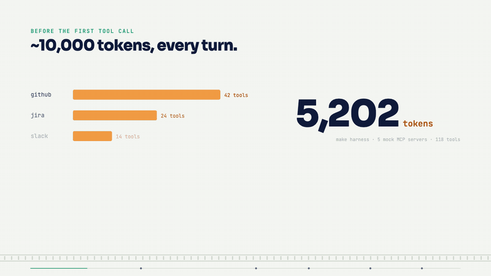
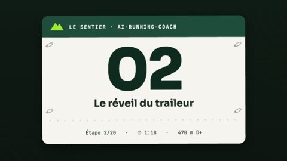
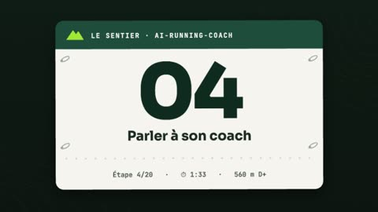
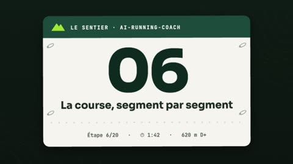
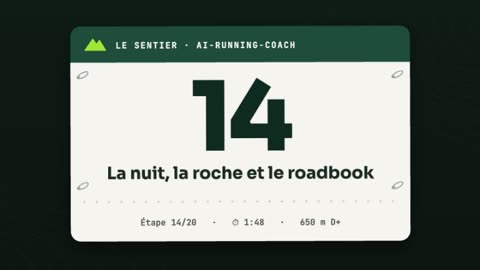
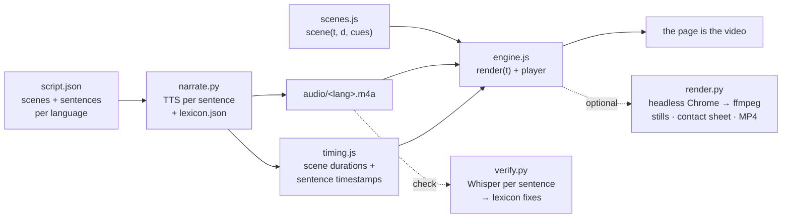

<div align="center">

# 🎬 canvas-video-skill

### Narrated product videos that are *web pages*, not video files.

Every frame drawn in JavaScript on a canvas · a free synthetic voice-over · subtitles, chapters, any language · written by your coding agent.

<a href="https://mmornati.github.io/canvas-video-skill/leanproxy-mcp/?lang=en">
  
</a>

**[▶ Watch it with sound](https://mmornati.github.io/canvas-video-skill/leanproxy-mcp/?lang=en)** · [en français](https://mmornati.github.io/canvas-video-skill/leanproxy-mcp/?lang=fr) · [in italiano](https://mmornati.github.io/canvas-video-skill/leanproxy-mcp/?lang=it) · [the story behind it](https://blog.mornati.net/canvas-videos-with-voice-over-in-javascript/)

[](#-install)
[](skills/canvas-video/references/tts-engines.md)
[](#-how-it-works)
[](LICENSE)

</div>

---

That GIF is a lossy capture. The real thing is an 80-second explainer that **runs in your browser**: pause it, scrub it, switch the narration between English, French and Italian, turn on subtitles, jump to a chapter. No MP4, no YouTube, no video editor, no microphone. It was made with this skill, in an afternoon, by asking Claude Code for it.

```text
> Make an ~80 s narrated explainer of github.com/mmornati/leanproxy-mcp, in EN, FR and IT,
  with a free voice I'm allowed to publish. Only facts from the repo.
```

## 🍿 Made with it

**[leanproxy-mcp in 80 seconds](https://mmornati.github.io/canvas-video-skill/leanproxy-mcp/?lang=en)**: the reference example in [`docs/leanproxy-mcp/`](docs/leanproxy-mcp). Eight scenes, three languages, Kokoro voice, 2 MB in total.

**[The Trail ("Le Sentier")](https://mmornati.github.io/ai-running-coach/videos/)**: the series this skill was extracted from. A trailer and 20 narrated episodes documenting [ai-running-coach](https://github.com/mmornati/ai-running-coach), about 35 minutes per language, FR and EN.

<table>
<tr>
<td align="center"><a href="https://mmornati.github.io/ai-running-coach/video/?lang=en"></a><br><sub>The trailer</sub></td>
<td align="center"><a href="https://mmornati.github.io/ai-running-coach/video/bilan-matinal/?lang=en"></a><br><sub>Morning check</sub></td>
<td align="center"><a href="https://mmornati.github.io/ai-running-coach/video/garde-fous/?lang=en"></a><br><sub>The plan that says no</sub></td>
</tr>
<tr>
<td align="center"><a href="https://mmornati.github.io/ai-running-coach/video/chat-coach/?lang=en"></a><br><sub>Talk to your coach</sub></td>
<td align="center"><a href="https://mmornati.github.io/ai-running-coach/video/jour-de-course/?lang=en"></a><br><sub>Race day, segment by segment</sub></td>
<td align="center"><a href="https://mmornati.github.io/ai-running-coach/video/ultra/?lang=en"></a><br><sub>The night, the rock and the roadbook</sub></td>
</tr>
</table>

**[Hello, canvas video](https://mmornati.github.io/canvas-video-skill/hello/)**: what `new_video.py` gives you before you write a single scene (13 seconds).

## ✨ Why a web page beats a video file

| | MP4 on YouTube | canvas video |
|---|---|---|
| **Size** | 3.6 MB per language (the example, 1080p) | **2 MB for all three languages**: ~40 KB of code, the rest is voice |
| **Languages** | re-record, re-edit | translate `script.json`, re-run one command; scenes re-time themselves |
| **Updating** | open the editor again | change a sentence in a pull request; CI checks the voice was regenerated |
| **Review** | watch it | read the diff |
| **Subtitles, chapters, transcript** | extra work | generated from the same script |
| **Hosting** | a third-party player, tracking | a folder of static files next to your docs |
| **Need an MP4 anyway?** | | one command, frame-perfect (24 s for a 78 s video at 1080p) |

## 📦 Install

In Claude Code:

```text
/plugin marketplace add mmornati/canvas-video-skill
/plugin install canvas-video@canvas-video-skill
```

Or copy `skills/canvas-video` and `skills/narration-lexicon` into your project's `.claude/skills/` (or `~/.claude/skills/`). The scripts work with any agent, or with no agent at all.

**Requirements:** [`uv`](https://docs.astral.sh/uv/), `ffmpeg`, and Chrome (or `uvx playwright install chromium`) for stills and MP4. Nothing gets installed in your project: every script runs through `uv run --with …`.

## 💬 Then just ask

```text
> Make a 60-second video presenting this project for the README, in English.
> Add an episode to our video series for the feature in PR #142.
> The French voice says "Chromebook" instead of "Homebrew" — fix it.
> Translate the intro video to Italian and check the pronunciation.
> Export the trailer as an MP4 with burned-in subtitles for LinkedIn.
```

The skill makes the agent do the parts that matter:
- **Facts first.** It reads the repo, uses only real numbers, prints their conditions on screen, and labels opt-in features as opt-in.
- **Storyboard approval.** It shows you a scene-by-scene table before building anything.
- **It looks at its own output.** It renders a contact sheet of every scene in every language and reads it back, before you ever see a frame.
- **It listens to its own output.** The `narration-lexicon` skill transcribes every sentence with Whisper and fixes what the voice gets wrong.
- **Licence check.** It tells you whether you may publish the audio of the voice you picked.

## 🧠 How it works



Three ideas carry everything:

1. **A frame is a pure function of time.** `render(t)` redraws everything from `t`, with no state and no unseeded randomness. Playing, seeking and frame-by-frame export are all the same call.
2. **The voice sets the pace.** Each sentence is synthesised and measured, and the scenes last as long as what is said in them. Animations hook onto sentences, not seconds, which is how one `scenes.js` serves every language:
   ```js
   const a2 = at(cues, 1, 7.7);            // when the 2nd sentence starts
   pill(S.pay, 700, 560, { alpha: seg(t, a2, a2 + 0.5) });
   ```
3. **The audio is the master clock.** While the narration plays, the player follows `audio.currentTime`, so voice and image never drift, even on a slow machine.

## 🧰 What's inside

| | |
|---|---|
| [`skills/canvas-video`](skills/canvas-video/SKILL.md) | the workflow: facts → storyboard → scaffold → narrate → scenes → contact sheet → ship |
| `  engine/` | `engine.js` (player + ~30 drawing helpers, ~500 lines, no dependencies) and `player.css`, with self-hosted OFL fonts |
| `  scripts/new_video.py` | scaffolds a video that plays before you write a scene |
| `  scripts/narrate.py` | voice, timing and `--check` for CI. Engines: `kokoro`, `azure`, `espeak`, `say` |
| `  scripts/render.py` | `--sheet` contact sheets, `--still`, MP4, `--burn-subs` |
| `  references/` | [engine API](skills/canvas-video/references/engine-api.md) · [scene recipes](skills/canvas-video/references/scene-recipes.md) · [free TTS & licences](skills/canvas-video/references/tts-engines.md) |
| [`skills/narration-lexicon`](skills/narration-lexicon/SKILL.md) | the pronunciation loop: verify → triage → try variants → lexicon → re-narrate |
| `  scripts/verify.py` | Whisper transcription per sentence, diffed against the script (numbers normalised) |
| `  scripts/try_words.py` | A/B spellings or IPA in the video's own voice, transcribed back |
| [`docs/`](docs) | the live examples (GitHub Pages) |

## 🗣️ Voices: free, and publishable

The default voice is **[Kokoro](https://huggingface.co/hexgrad/Kokoro-82M)**: 82M parameters, Apache-2.0, runs on a laptop CPU. It is excellent in English and decent in French and Italian; it also speaks Spanish, Portuguese, Hindi, Japanese and Chinese.

| Engine | Publish the audio? | |
|---|---|---|
| `kokoro` | ✅ Apache-2.0 | default, offline |
| `azure` | ✅ licensed, 500k chars/month free | the Microsoft neural voices, officially |
| `espeak` | ✅ no claim on your audio | robotic, zero-cost fallback |
| `say` (macOS) | ❌ Apple's licence forbids it | drafts only |

Chatterbox, Kyutai Pocket TTS, Piper, Google, Gemini, Polly, ElevenLabs and edge-tts (unlicensed, and returning 403 in the EU since October 2026) are compared in **[tts-engines.md](skills/canvas-video/references/tts-engines.md)**, along with the non-commercial traps to avoid.

## ⌨️ Without an agent

```bash
S=path/to/canvas-video-skill/skills
python3 $S/canvas-video/scripts/new_video.py docs/videos/intro --title "My project" --langs en,fr
python3 $S/canvas-video/scripts/narrate.py --download-model                                  # once, ~340 MB
uv run --with kokoro-onnx --with soundfile $S/canvas-video/scripts/narrate.py docs/videos/intro
uv run --with faster-whisper --with num2words $S/narration-lexicon/scripts/verify.py docs/videos/intro
uv run --with playwright $S/canvas-video/scripts/render.py docs/videos/intro --sheet
python3 -m http.server -d docs/videos 8000                                                   # open /intro/
```

Embed it anywhere:

```html
<div style="container-type:inline-size">
  <iframe src="/videos/intro/?embed=1&lang=en" title="My project" loading="lazy" allow="fullscreen; autoplay"
          allowfullscreen style="display:block;width:100%;height:calc(56.25cqw + 40px);border:0"></iframe>
</div>
```

## 🙏 Credits

Extracted from the [ai-running-coach](https://github.com/mmornati/ai-running-coach) video series. The "every frame is a function of time" approach was inspired by Addy Osmani's "how browsers work" canvas demo. The voice is [Kokoro-82M](https://huggingface.co/hexgrad/Kokoro-82M) by hexgrad, run through [kokoro-onnx](https://github.com/thewh1teagle/kokoro-onnx), and the speech-to-text is [faster-whisper](https://github.com/SYSTRAN/faster-whisper). The fonts are Inter, Sora and JetBrains Mono (SIL OFL, licences in `engine/fonts/`).

Code: [MIT](LICENSE). The example video's narration was generated with Kokoro (Apache-2.0).
